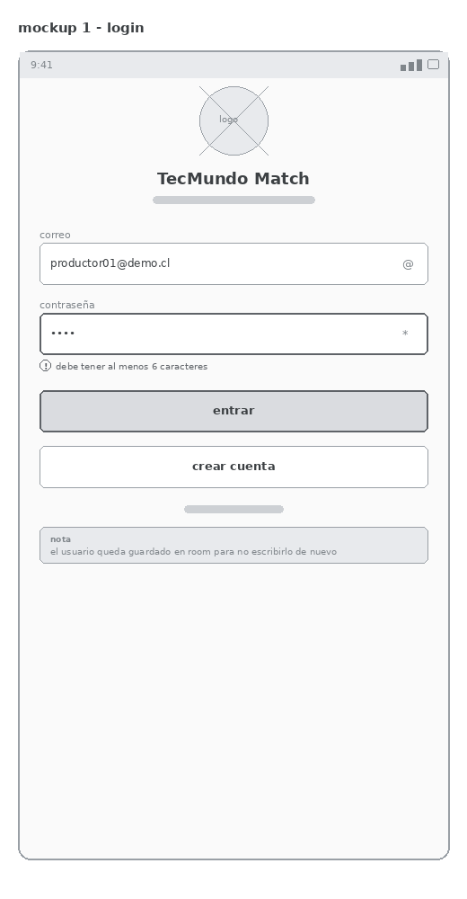
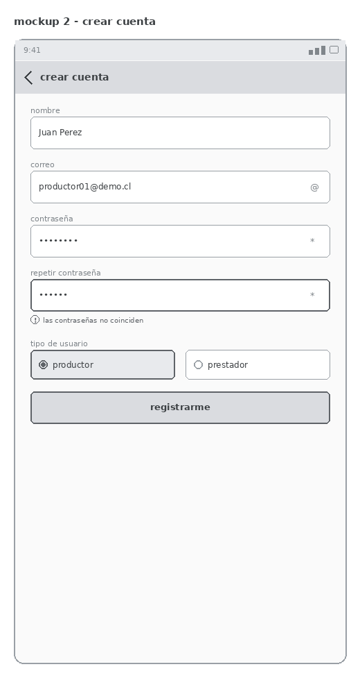
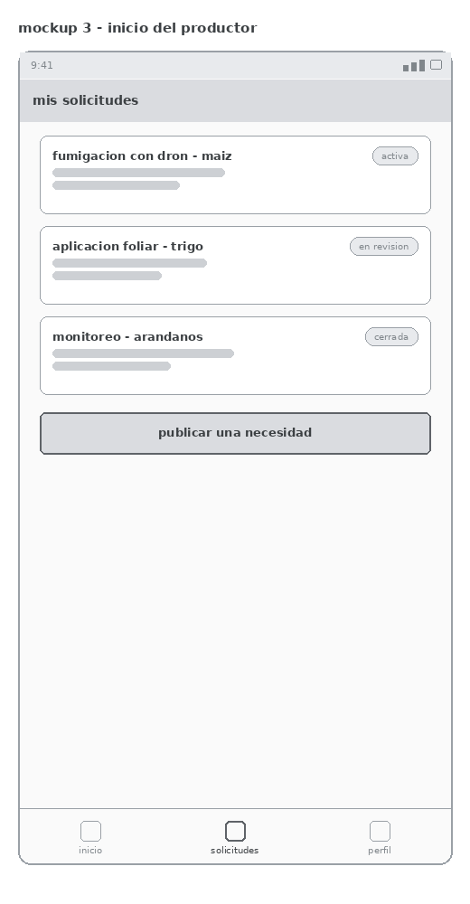
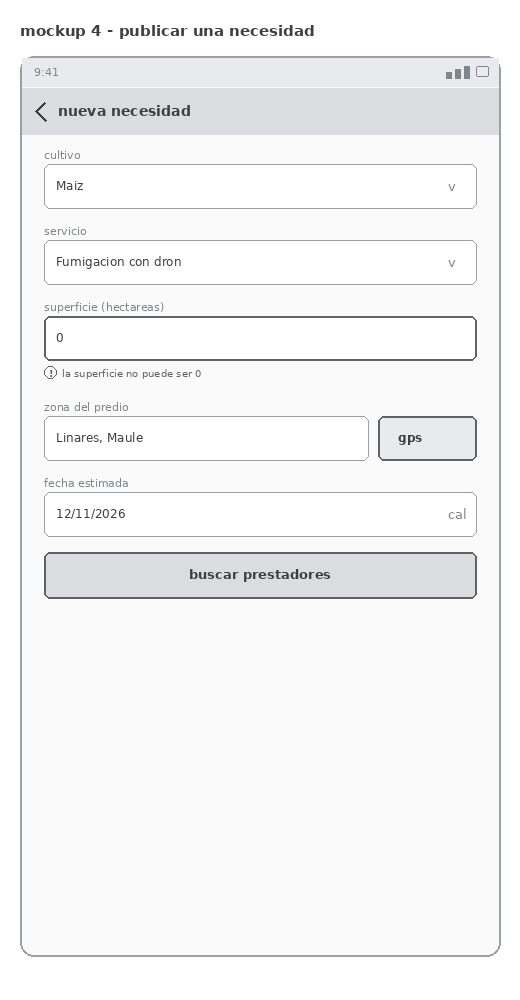
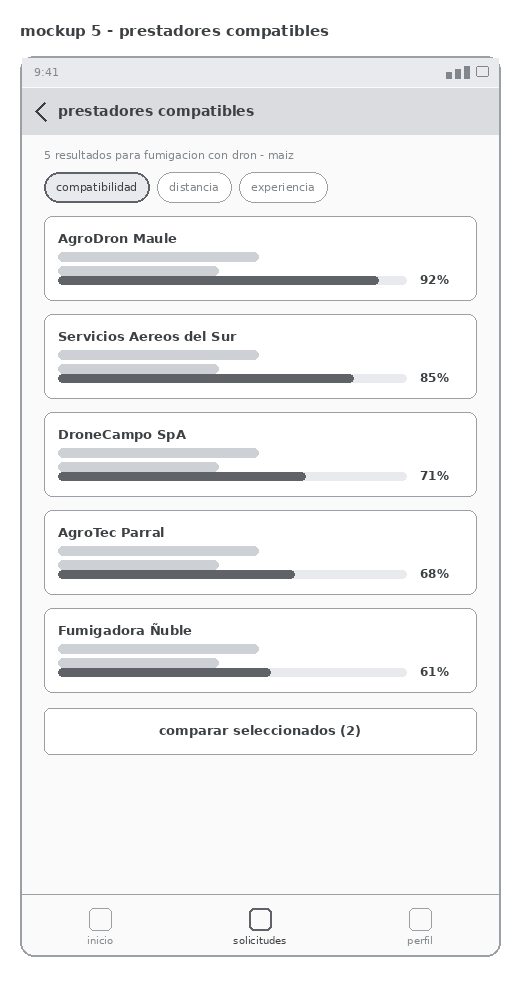
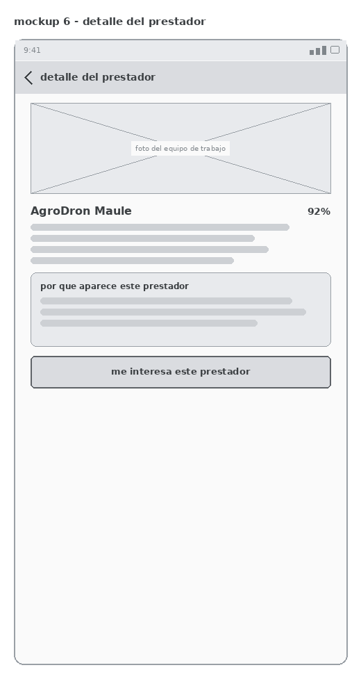
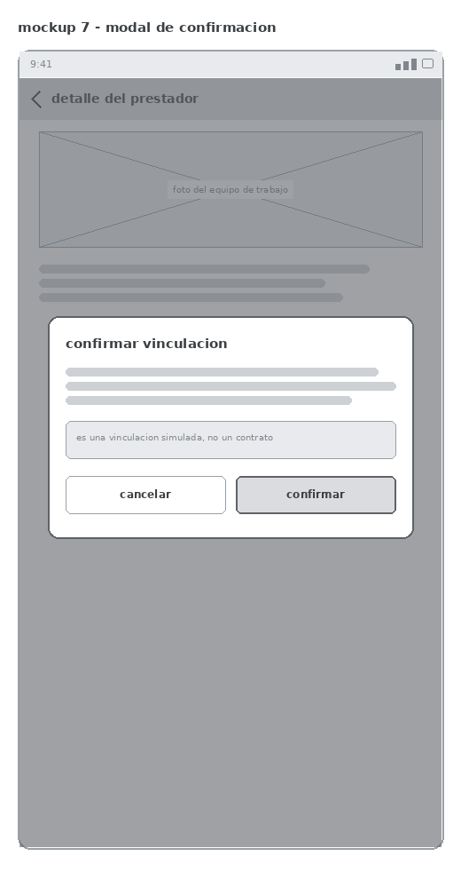
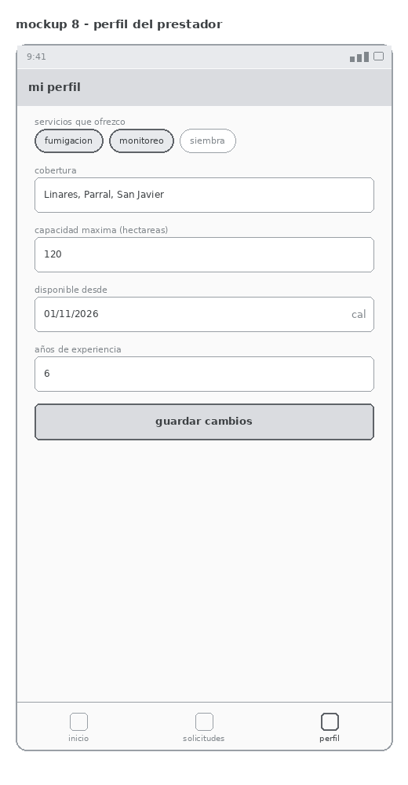

# Mockups - TecMundo Match

Estos son los mockups que armamos antes de empezar a programar, para tener claro
qué pantallas necesita la app y qué va en cada una.

Los dejamos en gris a propósito. La idea era definir primero la estructura de cada
pantalla, dónde va cada cosa y cómo se pasa de una a otra, sin pelear con los
colores. La paleta la aplicamos cuando empecemos a programar las vistas.

El caso es el de TECMUNDO (Duoc UC, DSY1105). La empresa trabaja con drones y
agricultura de precisión, y lo que nos piden es un MVP que conecte a los
agricultores que necesitan un servicio con los prestadores que lo ofrecen.
La app no hace contratos ni pagos, solo llega hasta la vinculación simulada.

La app la vamos a llamar **TecMundo Match**.

## Paleta de colores

Esta es la paleta que acordamos para cuando programemos las pantallas. Elegimos
verde porque la app es del rubro agrícola y se entiende al tiro de qué se trata.

| Uso | Color |
|---|---|
| Verde principal (barra superior, botones) | `#2E7D32` |
| Verde claro (avisos y etiquetas) | `#E8F5E9` |
| Fondo de las pantallas | `#F8FAF8` |
| Texto principal | `#212523` |
| Texto secundario | `#6E7671` |
| Rojo de error | `#C62828` |
| Naranjo de estado pendiente | `#F57C00` |

## Las pantallas

### 1. Login

La primera pantalla. Tiene el formulario con correo y contraseña, y los dos campos
se validan: si el correo no tiene formato válido o la contraseña es muy corta,
el borde se pone rojo y aparece el mensaje abajo.

El usuario que inicia sesión se guarda en Room, así cuando vuelve a abrir la app
no tiene que escribir los datos otra vez.

Acá también va la animación del logo al entrar.

### 2. Crear cuenta

Formulario de registro con las mismas validaciones. Lo importante es que acá se
elige el tipo de usuario: productor o prestador, porque después la app muestra
cosas distintas según cuál sea.

### 3. Inicio del productor

Lo primero que ve el productor cuando entra. Son sus solicitudes en tarjetas, cada
una con su estado (activa, en revisión, cerrada) y el botón grande abajo para
publicar una nueva.

Abajo está la barra de navegación con las tres secciones.

### 4. Publicar una necesidad

Este es el formulario más importante de la app. El productor pone el cultivo, el
servicio que necesita, cuántas hectáreas, la zona y la fecha.

La superficie no puede ser 0 ni quedar vacía, por eso en el mockup la dejamos con
el error marcado para que se vea cómo se avisa.

El botón GPS llena la zona con la ubicación aproximada del celular, pero igual se
puede escribir a mano, porque el caso dice que la ubicación puede ser simulada.

### 5. Prestadores compatibles

Acá se ve el resultado del matching. Cada prestador aparece con su porcentaje de
compatibilidad, que se calcula comparando zona, cultivo, servicio, capacidad y
disponibilidad con lo que pidió el productor.

Arriba hay filtros para ordenar la lista y abajo el botón para comparar dos
prestadores.

Cuando el matching termina se manda una notificación al celular avisando que ya
hay resultados.

### 6. Detalle del prestador

Toda la información del prestador: servicios, cobertura, experiencia, desde cuándo
está disponible y una evaluación de ejemplo.

Arriba va la imagen del equipo de trabajo.

El recuadro de "por qué aparece este prestador" lo pusimos para que se entienda de
dónde sale el porcentaje y no quede como un número mágico.

### 7. Confirmación de la vinculación

Cuando el productor aprieta "me interesa este prestador" sale este modal. Deja claro
que es un flujo simulado y no un contrato ni un pago, que es lo que pide el caso.

La vinculación queda guardada en Room y se puede ver después en Mis solicitudes.

### 8. Perfil del prestador

Esta es la pantalla que ve el otro tipo de usuario. El prestador edita sus servicios,
su cobertura, la capacidad máxima en hectáreas y desde cuándo está disponible.

Esos datos son los que después usa el matching para compararlo con las necesidades
publicadas.

## Dónde queda cada requisito de la evaluación

| Requisito | Dónde |
|---|---|
| Formulario | Login, registro, nueva necesidad, perfil del prestador |
| Validación de campos | Los cuatro formularios, con borde rojo y mensaje |
| Imagen | Foto del equipo en el detalle del prestador |
| Animación | Logo del login y entrada de las tarjetas de resultados |
| Modal | Confirmación de la vinculación |
| Persistencia con Room | Usuario del login, necesidades publicadas y vinculaciones |
| Navegación entre vistas | Barra inferior y el paso de una pantalla a otra |
| Recurso nativo 1 (GPS) | Botón GPS de la zona del predio |
| Recurso nativo 2 (notificaciones) | Aviso cuando el matching encuentra prestadores |

## Cómo seguimos

Los mockups todavía pueden cambiar cuando empecemos a programar, sobre todo el
cálculo del porcentaje de compatibilidad, que es la parte que falta definir mejor.

Cada pantalla tiene su issue en el milestone de mockups, repartidos entre los dos.
